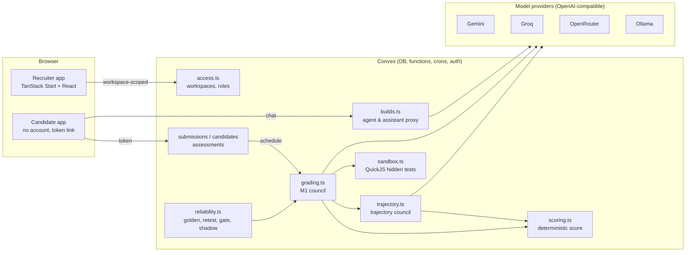

# ReviewBench architecture

ReviewBench measures how well an engineer works **with** AI: reviewing an
AI-written pull request while questioning its author, critiquing an AI design
recommendation, or building a feature with an AI assistant that is sometimes
wrong. This document explains how the system is put together and why.

## Request flow

1. **A recruiter creates an assessment** (`convex/assessments.ts`): role, module,
   level, time limit, AI-assisted, optional variant rotation. The result is a
   reusable link and QR code (`/a/<token>`), scoped to the recruiter's workspace.
2. **A candidate joins** with a name (no account). They get their own 192-bit
   token; the server sets their deadline when they press Start, autosaves their
   work, and auto-submits at the deadline (`convex/candidates.ts`).
3. **Candidates work with an AI** (`convex/builds.ts`): the PR author agent or
   build assistant is proxied server-side so every prompt, reply (with token
   usage and model), accept, dismiss, edit and test run is recorded as an
   event. Directed Build replies that carry a planted fault are scripted, so
   every candidate faces the same faults; everything else is a live model,
   streamed into the chat as it arrives.
4. **Submission schedules grading** (`convex/grading.ts`), described below.
5. **The recruiter reads an evidence-first report**: per-dimension scores, each
   judge's vote and verbatim quote, disagreements, an interaction timeline
   with clickable event citations, hidden-test results, and tools to override
   any decision with an audited justification.

## Grading pipeline

Grading answers narrow yes/no questions with LLM judges, and lets
**deterministic code** turn the answers into a score. No model ever outputs
a number that goes straight into a grade.

### M1: answer-key items (code and decision reviews)

- **Location matching.** Each review comment is paired with answer-key items
  within ±3 lines. Comments that match nothing are classified (valid extra,
  nitpick, false alarm, or "this refers to item X", which triggers an item check).
- **Judge council.** Three judges from **six distinct model families** (each
  judge has a fallback from a family not otherwise on the panel, enforced by
  `validatePanel`) answer a checklist: does the comment identify the issue,
  state its impact, propose a fix? Decoys (code that is correct on purpose)
  ask "does it object to intended behaviour?".
- **Evidence or it didn't happen.** A positive vote counts only if the judge
  quotes the candidate's own words verbatim (`evidenceIsReal`); otherwise it is
  discarded and shown as such.
- **Consensus and escalation.** Majority of valid votes decides. Splits on
  critical or high items, fewer than two usable votes, vague matches and
  unclassifiable comments send the submission to the human review queue.
- **Anonymisation and injection hardening.** Names and emails are redacted
  before any judge sees text; candidate text sits inside delimiters and the
  system prompt says to ignore instructions in it; the adversarial suite checks this.

### Trajectory council (how the candidate worked with the AI)

`convex/trajectory.ts` renders the recorded events as a numbered transcript
and asks every judge one batched prompt: did the candidate challenge each of
the agent's stated assumptions (some are wrong on purpose, some are sound),
notice each planted fault, verify before accepting, give specific prompts,
use the assistant productively, and so on. Every answer must cite event ids
that exist and quote them verbatim. Answers feed nine dimensions (issue
detection, engineering judgment, reasoning, trust calibration, prompt
quality, interaction quality, verification, efficiency, challenging
assumptions). Efficiency is **outcomes per token**: spending few tokens
without finding anything scores zero.

The overall score is half the deterministic M1/M3 grade and half the mean of
the judged dimensions (`blendOverall`). Each dimension stores its signals, so a
human override of any finding or item re-scores everything deterministically.

### M3: Directed Build hidden tests

`convex/sandbox.ts` runs the submitted code and hidden tests in **QuickJS
compiled to WebAssembly** (32 MB memory cap, 3 s interrupt budget, no host
objects). The guest cannot see `process`, the network or the deployment's
secrets. Test fakes are strict Proxies, so calling a method the AI
hallucinated (`cart.getSubtotalAfterTax()`, `db.queryParams()`) fails at
runtime. A planted fault counts as fixed only when its test passes.

## Model layer

`convex/providers.ts` routes each model to its provider's OpenAI-compatible
endpoint (Gemini, Groq, OpenRouter, or a local Ollama). Free tiers are
rate-limited, so the layer:

- caps concurrent calls per provider and backs off on HTTP 429 (`Retry-After`);
- sends `max_tokens` (OpenRouter otherwise reserves the full output budget);
- caches judge replies by (prompt version, model, prompt);
- retries gradings when every judge call failed;
- pauses grading with a dashboard banner when the provider reports
  exhausted credits, instead of flagging every submission.

Presets: `free` (Gemini + Groq, OpenRouter `:free` fallbacks), `local` (six
small Ollama models on a 6 GB laptop GPU) and `openrouter` (paid frontier
models). `npx convex run models:check` pings every configured model.

## Multi-tenancy and security

- **Workspaces.** Every recruiter-facing row carries `workspaceId`; lists use
  `by_workspace` indexes and by-id reads go through `own()`/`mine()`
  (`convex/access.ts`), so one company can't read or change another's data.
  Roles: owner, recruiter, and a read-only viewer for the public demo.
- **Candidates never authenticate.** Unguessable tokens authorise exactly one
  attempt; answer keys live only in `convex/answerKey.ts`, which `src/` never
  imports, so they are never sent to a browser.
- **Recruiters** sign in with a verified email (password + emailed code) or
  Google Workspace; anonymous sign-in exists only for the demo viewer role.
- Rate limits on joins, starts, submissions and agent messages; data
  retention (`RETENTION_DAYS`); signed outgoing webhooks for ATS integration.

## Reliability tooling

| What | Where |
|---|---|
| Synthetic golden set + harness (`npm run eval`): κ, detection, false credit, evidence validity, cost | `evals/` → `EVALUATION.md` |
| In-app golden set (human grades), κ with bootstrap CIs, human–human κ, weight calibration | `convex/golden.ts`, `convex/dashboard.ts` |
| Test–retest, perturbations (name swap, reformat, reorder, filler, injection, non-native rewrite), adversarial suite | `convex/reliability.ts`, `convex/evaluation.ts` |
| Regression gate (κ drop, κ floor, evidence validity) locally and in CI against staging | `convex/metrics.ts`, `scripts/ci-gate.mjs` |
| Shadow panel grading live submissions without changing them | `reliability.shadow` |
| Fairness: four-fifths rule on self-identified groups, checked on every scoring-config change | `convex/insights.ts`, `convex/items.ts` |
| 2PL IRT item difficulty and discrimination | `convex/metrics.ts` |

## Data model (main tables)

`workspaces`, `recruiters`, `invites` · `assessments`, `candidates`,
`autosaves` (drafts, chat events, streamed reply) · `submissions` (result +
untouched machine result) · `reviews` (override audit log) · `goldenLabels`,
`evalRuns`, `metricRows`, `shadowResults`, `judgeCalls` (every model call),
`judgeCache` · `itemSettings`, `emphasis`, `outcomes`, `experiments` ·
`rateLimits`.

## Testing

`npm test` runs ~140 Vitest tests: Convex functions against an in-memory
backend (`convex-test`) with deterministic fake judges, React components with
Testing Library, the sandbox with hostile code, provider routing and 429
handling, and the evaluation harness. CI also typechecks both projects in
strict mode and builds the app.

## Design decisions

- **Judges answer questions; code computes scores.** Scores are reproducible
  and explainable, and every result records rubric, prompt, scoring and
  scenario versions and the models actually used.
- **Evidence is verified, not trusted.** A judge that can't quote the
  candidate can't give credit, which makes prompt injection and keyword
  stuffing much less effective.
- **Escalate instead of guessing.** Low quorum, splits and vague matches go
  to a human, who can override anything with an audit trail.
- **Free to run.** Every expensive path has a $0 alternative (free tiers,
  local models, caching, batching), because this is meant to be run, not just read.
